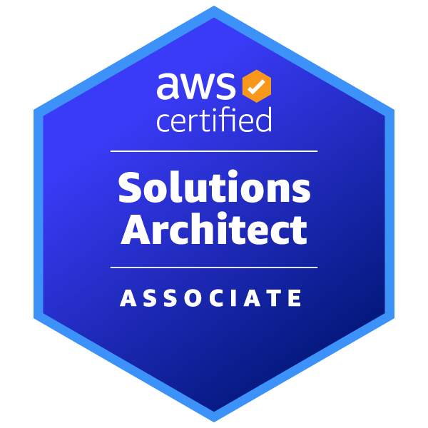
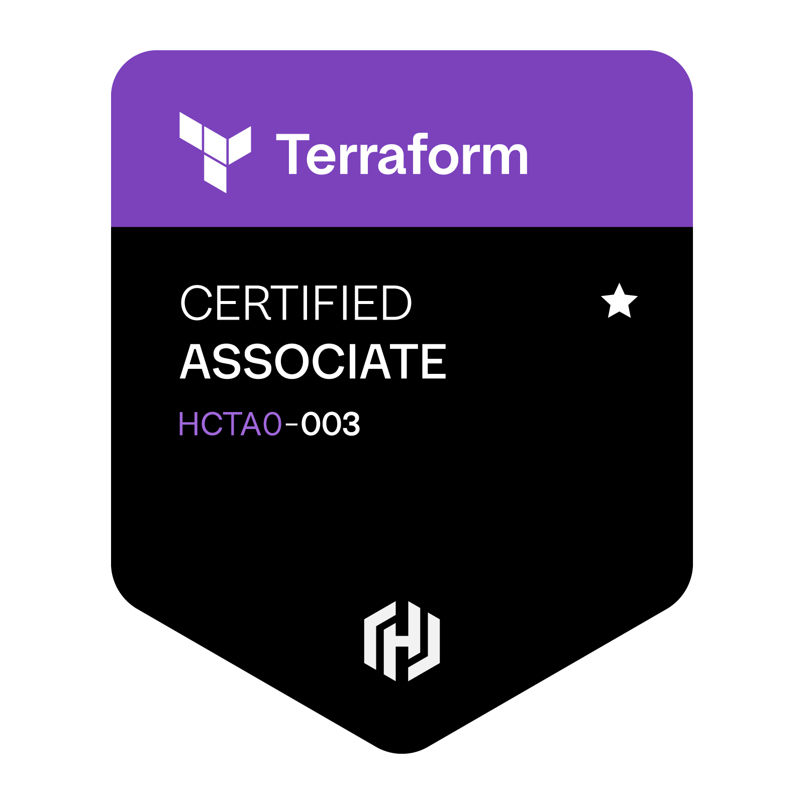
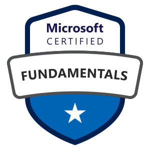

# 👋 Hi, I'm Claude Emmanuel

## ☁️ Cloud & DevOps Engineer

### AWS • Azure • Terraform • Kubernetes • Linux

I build, automate and secure cloud infrastructure using **AWS, Azure, Terraform, Kubernetes and Linux**.

My focus is turning infrastructure requirements into **reliable, scalable and secure cloud solutions** through Infrastructure as Code, automation, container orchestration and DevOps practices.

> **BUILD → AUTOMATE → SECURE → OPERATE**

---

<h2>🛠️ Tech Stack</h2>

  

  <b>Cloud • Infrastructure as Code • Linux • Containers • Kubernetes • CI/CD • Automation • Observability</b>

 

## 🐧 Linux & Systems Administration

Hands-on experience administering Linux systems and using Linux as the foundation for Cloud and DevOps workloads.

- 👤 **User & Group Management** — users, groups, permissions and sudo access
- 🔐 **SSH Administration & Hardening** — secure remote access and SSH configuration
- 🛡️ **Security** — SELinux, permissions and system hardening
- 🔥 **Networking & Firewall** — Linux networking, ports and iptables
- ⚙️ **Services & Processes** — systemd, services, processes and logs
- ⏰ **Task Automation** — cron jobs and Bash scripting
- 📦 **Package Management** — software installation and system updates
- 🤖 **Configuration Management** — Ansible automation
- 🌐 **Web & Application Services** — Apache, Tomcat and MariaDB

<h2>🏅 Certifications</h2>

&nbsp;&nbsp;&nbsp;&nbsp;
&nbsp;&nbsp;&nbsp;&nbsp;

<strong>AWS Solutions Architect</strong> &nbsp; • &nbsp; <strong>Terraform Associate</strong> &nbsp; • &nbsp; <strong>Azure Fundamentals</strong>

  

## 📌 Featured Cloud & DevOps Projects

### ☁️ AWS Infrastructure with Terraform

**Repository:** [View Project on GitHub](https://github.com/emmacl5/aws-tf-baseline)

**Technologies:** AWS · Terraform · VPC · S3 · DynamoDB

Infrastructure as Code project demonstrating:

- AWS VPC networking with public and private subnets
- Terraform modules for reusable infrastructure
- Remote Terraform state using Amazon S3
- State locking and infrastructure configuration
- AWS networking components including NAT Gateway and Internet Gateway

**Focus:** Infrastructure automation, modular design, and cloud networking.

### ⚡ AWS Serverless URL Shortener

**Repository:** [View AWS Mini Projects](https://github.com/emmacl5/aws-mini-projects)

**Technologies:** AWS Lambda · Amazon API Gateway · DynamoDB · Python

A serverless URL-shortening application built using AWS managed services.

**Key Features:**
- REST API endpoints using Amazon API Gateway
- Serverless application logic with AWS Lambda
- URL mapping and storage using DynamoDB
- Cloud-native architecture without managing servers

**Focus:** Serverless computing, API development, and AWS application architecture.

### 🔷 Microsoft Azure Administrator Labs

**Repository:** [View Azure Administrator Labs](https://github.com/emmacl5/az-104-azure-administrator-labs)

**Technologies:** Microsoft Azure · Microsoft Entra ID · Azure RBAC · Azure Storage · Azure Virtual Machines

Hands-on Azure administration labs focused on identity, access management, storage, and cloud infrastructure.

**Key Features:**
- Microsoft Entra ID user and group administration
- Role-Based Access Control (RBAC) and permission management
- Azure Storage accounts, SAS tokens, and Azure Files
- Storage redundancy and replication configurations
- Azure virtual machine provisioning and network security

**Focus:** Azure administration, identity and access management, cloud security, and infrastructure operations.

### ☸️ Containerized Microservices on Amazon EKS

**Repository:** [View Kubernetes Project](https://github.com/emmacl5/03-containerized-microservices-on-eks)

**Technologies:** Kubernetes · Docker · Amazon EKS · AWS · Microservices

Hands-on project exploring containerized application deployment and Kubernetes orchestration on AWS.

**Project Objectives:**
- Containerize application services using Docker
- Understand Kubernetes Pods, Deployments, and Services
- Practice container orchestration and service networking
- Explore running microservices on Amazon EKS
- Develop Kubernetes troubleshooting and deployment skills

**Focus:** Container orchestration, Kubernetes administration, and cloud-native application deployment.

---

## 🎓 Education

**Bachelor of Engineering (B.Eng.) – Information and Communications Technology**

**Metropolia University of Applied Sciences** 🇫🇮

During my studies, I built a strong foundation in Networking, Cloud computing, databases, operating systems and IT infrastructure, which now supports my work in Cloud and DevOps engineering.

---

## 🚀 Current Focus

- Building production-ready AWS projects
- Improving Terraform and Infrastructure as Code skills
- Practicing Kubernetes and DevOps workflows
- Sharing my learning journey through GitHub, LinkedIn and YouTube

---

## 🌐 Connect with Me

| Platform | Link |
|--------- |------|
| GitHub   | https://github.com/emmacl5 |
| LinkedIn | https://www.linkedin.com/in/claude-emmanuel-ouamba-418421116/ |

---

## 📈 GitHub Activity

I use GitHub to document my cloud engineering journey, publish hands-on projects and build a portfolio that demonstrates practical AWS and DevOps skills.
